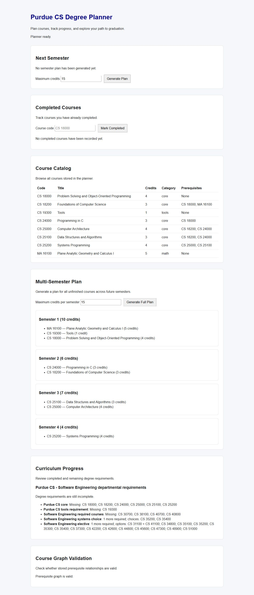

# Purdue CS Degree Planner — portfolio draft

**A planning prototype that turns course prerequisites and completed courses into semester previews.** It combines a Python planning engine, SQLite persistence, a command-line interface, a FastAPI API, and a small browser interface. The included eight-course catalog demonstrates a limited Purdue CS core pathway; the curriculum file models a broader subset of Software Engineering requirements.

## What the prototype demonstrates

- Stores a course catalog, prerequisite relationships, and completed courses in SQLite.
- Detects missing prerequisite references and cycles before ordering a course graph.
- Builds one-semester and multi-semester previews under a credit limit. Prerequisites must be completed before the semester in which a dependent course appears.
- Calculates curriculum progress for required courses, choices, and paired-course options without allocating one completed course to two requirements.
- Exposes the same project through a CLI, HTTP API, and browser page.

## Engineering decisions

The prerequisite graph is processed with a manual topological sort. The multi-semester planner then checks which unfinished courses are available at the start of each semester. It generates credit-limited combinations and ranks them by dependency depth and credit use. This is a local heuristic, not a proof of the shortest possible schedule. Generating combinations can become expensive when many courses are available at once.

The planner keeps *recorded completions* separate from *courses added to a preview*. Generating a plan does not change the database. Recording a completion does, and the next preview uses that updated record.

## Evidence and demo

- [Written demo walkthrough](demo_walkthrough.md)
- [Initial dashboard](images/01-dashboard.jpg)
- [Four-semester preview](images/02-four-semester-plan.jpg)
- [Updated preview after recording CS 18000](images/03-replanned-after-completion.jpg)
- [Source notes for the demo catalog](../data/purdue_cs_core_demo.md)
- Run checks with `python -m pytest` and `node --test tests/test_frontend.cjs`.

## Scope and ownership

This is a departmental planning prototype. It does not model every Purdue degree requirement, concurrent enrollment, placement, minimum grades, alternative credit, term offerings, or enrollment availability. The eight-course demo cannot satisfy every requirement in the broader curriculum file. It should not be used as enrollment advice.

The project was developed through guided learning and AI-assisted implementation. Commits and `codex-built/*-review-later` tags identify work to revisit before describing personal implementation details in an application or interview. Replace this draft with a contribution statement you can explain accurately in your own words.
