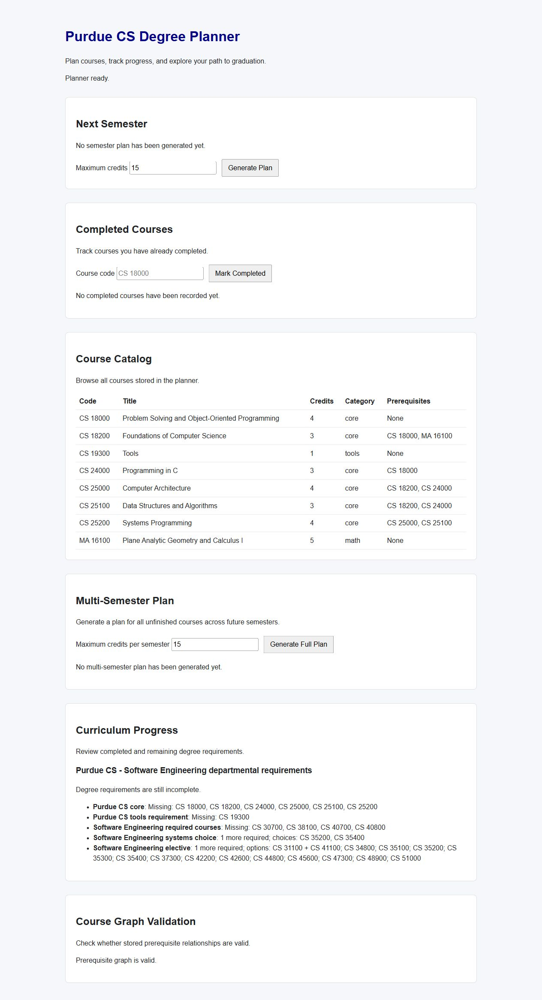
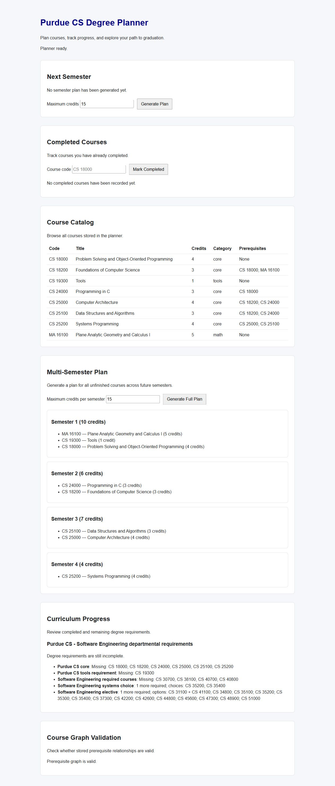
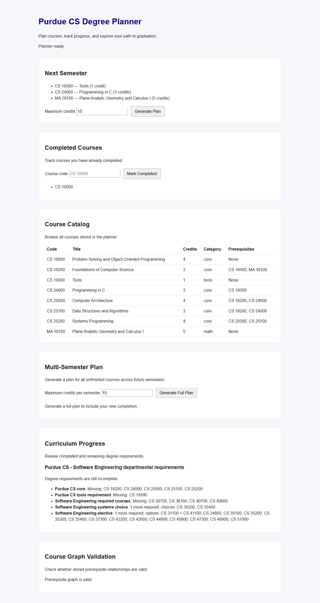

# Written demo walkthrough

These steps use the [eight-course demo catalog](../data/purdue_cs_core_demo.md) and a fresh, disposable database. The screenshots were captured from the browser interface with a 15-credit limit. Follow the [main README](../README.md#api) to run the app in a fresh clone. The import command adds courses; it does not clear an existing database.

## 1. Open the dashboard

The catalog shows eight courses. The prerequisite graph reports valid. The progress panel shows missing courses because no completions have been recorded. The curriculum file also contains Software Engineering requirements beyond this eight-course catalog.

## 2. Generate a full plan

Click **Generate Full Plan** with the 15-credit default. The demo produces:

| Semester | Courses | Credits |
| --- | --- | ---: |
| 1 | MA 16100, CS 19300, CS 18000 | 10 |
| 2 | CS 24000, CS 18200 | 6 |
| 3 | CS 25100, CS 25000 | 7 |
| 4 | CS 25200 | 4 |

CS 18000 appears before CS 24000, and CS 25000 plus CS 25100 appear before CS 25200. The order of courses *within one semester* is display order, not an instruction to take one before another. This is a preview; it does not mark any course complete.

## 3. Record a completion and replan

Enter `CS 18000` in **Course code**, then click **Mark Completed**. The completed list gains CS 18000, curriculum progress removes it from the missing core list, and the old plan is cleared because it no longer reflects current data. Click **Generate Plan** again. The new one-semester preview contains CS 19300, CS 24000, and MA 16100. CS 24000 is now available because its recorded prerequisite, CS 18000, is complete.

## What to explain aloud or in writing

1. A prerequisite is a graph dependency: completing CS 18000 unlocks CS 24000 in a later semester.
2. A preview uses a copy of completed courses while constructing future semesters; it does not save those future courses as completed.
3. The multi-semester choice rule favors courses on longer dependency chains, then credits used. It can miss the globally shortest plan.
4. The curriculum progress panel describes a broader requirement subset than the eight-course planning demo.

Use your own words for the algorithm and your contribution. The screenshots document behavior; they do not establish that this prototype is an official Purdue degree audit.
